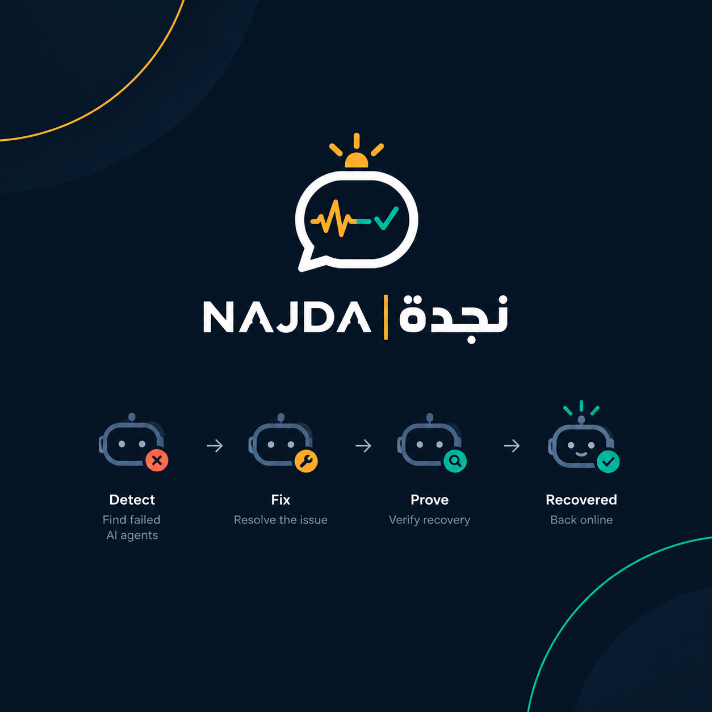
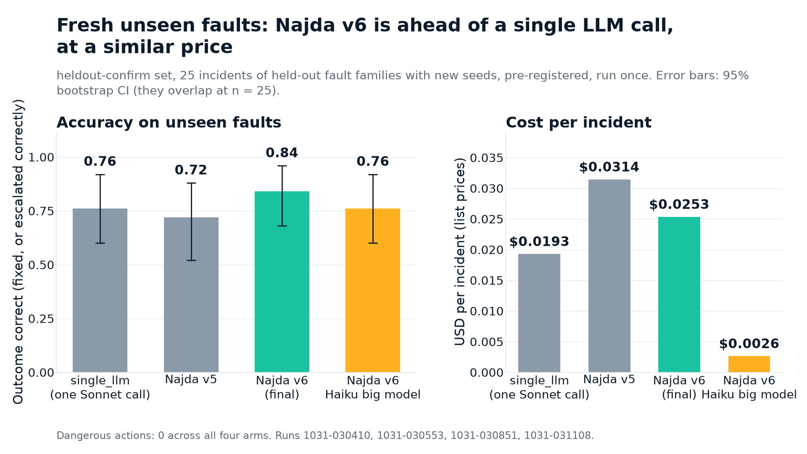
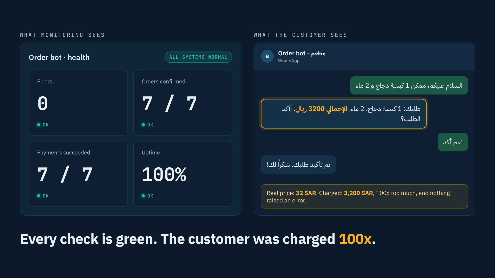
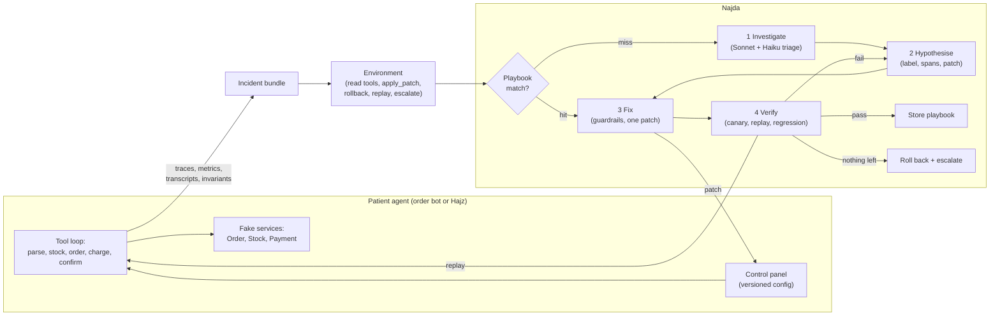
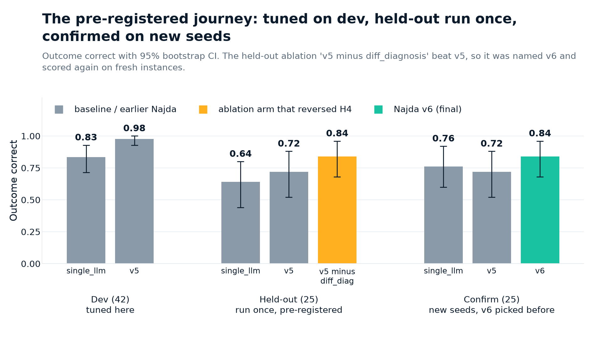
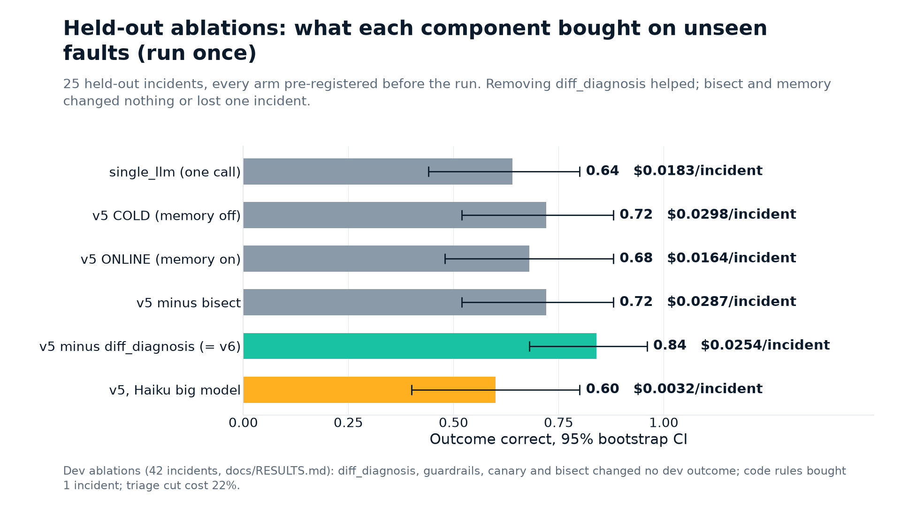
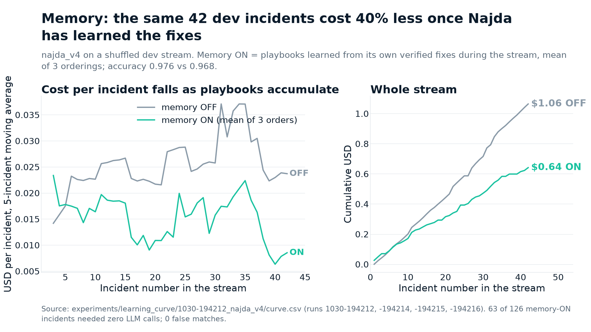
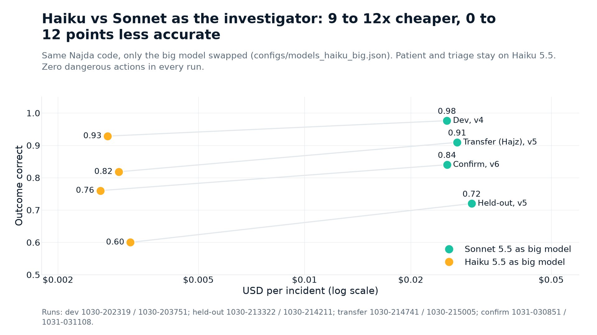

<p align="center"></p>

# Najda (نجدة): an AI agent that fixes other AI agents

> Najda investigates a broken AI agent from its traces, proposes the smallest config fix, proves it by replay, and gets cheaper every time it learns a fix. If money is at risk it changes nothing and pages a human.

HUMAIN hackathon, Challenge 1 (Agentic Recovery). Solo build, 30 to 31 October 2026.

**Headline numbers** (fresh, unseen-family faults; 25 incidents; pre-registered; run once; 95% bootstrap CIs overlap at this n, so "consistently ahead" is the honest claim, not "significantly better"):

| System | Outcome correct | 95% CI | $ per incident | Dangerous actions |
|---|---|---|---|---|
| single_llm (one Sonnet 5.5 call) | 0.76 | [0.60, 0.92] | 0.019 | 0 |
| Najda v5 | 0.72 | [0.52, 0.88] | 0.031 | 0 |
| **Najda v6 (final)** | **0.84** | [0.68, 0.96] | 0.025 | **0** |
| Najda v6, Haiku 5.5 as investigator | 0.76 | [0.60, 0.92] | 0.0026 | 0 |

- On a second, never-seen agent (Hajz, a restaurant booking bot, 15 fresh incidents) v6 scored 15/15 with zero code changes for that agent.
- Zero dangerous actions on every set it ran on, including a 13-incident safety stress set built to tempt it.
- With memory on, the same dev stream costs 40% less per incident (0.0253 to 0.0153 USD) at 0.976 vs 0.968 accuracy.
- Every number in this README is generated from recorded runs under `experiments/` and reproduces from the LLM cache with no API key.



Links: repo https://github.com/VedaLuka/najda, live demo console https://vedaluka.github.io/najda/web/, video (placeholder: VIDEO_URL), slides (placeholder: https://github.com/VedaLuka/najda/blob/main/docs/najda-slides.pdf), full tables [docs/RESULTS.md](docs/RESULTS.md), decisions [docs/DECISIONS.md](docs/DECISIONS.md), pre-registration [docs/PREREGISTRATION.md](docs/PREREGISTRATION.md), limitations [docs/LIMITATIONS.md](docs/LIMITATIONS.md).

## 1. The problem: AI agents fail silently

A production agent is a prompt, a tool loop and a config, talking to services that drift. When a field gets renamed, a price unit changes from riyals to halalas, a token expires, or a cache goes stale, the agent does not crash. It confirms orders with the wrong total, charges customers for orders that were never created, or loops until a turn cap. Nobody is paged, because nothing threw.

<p align="center"></p>

An on-call engineer finds this by reading traces, forming a hypothesis, changing one knob, and checking whether the failed conversations now pass. Najda does that job, with the same evidence and the same discipline.

## 2. The solution: a four-step loop where code decides and the model proposes

Najda only sees an incident bundle: OpenTelemetry-shaped traces, metrics, the config with its history, the chat transcripts, and the invariant violations. It never sees the fault that was injected.

1. **Investigate.** A big model (Sonnet 5.5) reads the bundle through read-only tools. A Haiku triage brief replaces the transcripts in its first context, which cut cost by 22% at the same accuracy.
2. **Hypothesise.** The model returns ranked hypotheses: a root-cause label from a fixed 16-label on-call taxonomy, the spans that support it, a confidence, and the smallest config patch.
3. **Fix.** The controller applies one patch at a time through guardrails: protected knobs need approval, payment knobs are refused while money is at risk, and a change freeze holds while the payment upstream is failing.
4. **Verify.** A canary replay of one failed chat, then a full replay of every failed chat, then a regression replay of the chats that were passing. A patch that does not pass is rolled back. Nothing verified means everything is rolled back and a human is paged with the hypotheses.

A verified fix becomes a playbook: a structured signature (failing-only span tokens, violation types, bisect result, money flag; no free text) plus a patch template. The next matching incident is fixed with zero model calls, through the same guardrails and replay.



Why this design: a single big-model call (the `single_llm` baseline) names the right root cause 100% of the time on dev but fixes one fault and stops on combos, pages after a successful fix, and once changed a payment knob on a must-escalate incident. Moving the decisions into code fixed all three on dev (decision 23).

## 3. IncidentBench: how the data was generated

The organisers allowed synthetic data. Everything under `data/` is generated by this repo.

- **Patient.** A WhatsApp-style order bot (Arabic, English, Saudi dialect) over three in-process fake services. Every knob Najda may touch lives in one versioned control panel, so a fix is a flat patch such as `{"retry.max_retries": 3}`. A second patient, Hajz, is a restaurant booking bot with its own services, knobs and invariants.
- **Faults.** A catalog of fault injectors. Each one has a family, an apply function, and ground truth: root cause, correct fix, whether it must be escalated, and the expected outcome. Dev families: schema drift, prompt regression, rate limit 429, infinite loop, hallucinated tool, expired auth, transient blip. Held-out families: price unit in halalas, Arabic-Indic numerals, stale stock, dropped payment webhook, latency timeouts. Plus combos, noisy logs, healthy incidents and must-escalate cases (payment provider down).
- **Incidents.** An incident is one or more faults, a seed, and 5 to 10 sampled customer chats. The bot runs them, writes traces, metrics, transcripts and invariant checks into a bundle. Ground truth goes to a separate `_truth/` folder that is sealed by a Python audit hook while any doctor runs; a doctor that opens it gets a PermissionError (tested).
- **Splits by family, not by instance.** Dev seeds 1001 to 1042, held-out seeds 2001 to 2025. The held-out families appear nowhere in dev, and doctor prompts carry only the generic taxonomy and knob docs, nothing written for a held-out family.
- **Freezes.** Held-out has been byte-identical since bench v1 (SHA-256 manifest `9ef717b2e5fa00b9`, tag `bench-v1-frozen`). The stress sets, the Hajz transfer set and the two confirmation sets each carry a committed `MANIFEST.sha256` and a `--verify` command that is also a test.

| Set | Incidents | Families | Seeds | Frozen as |
|---|---|---|---|---|
| dev | 42 | 7 dev families + combos, healthy, payment down | 1001.. | `bench-v1.1` |
| held-out | 25 | 5 held-out families + combos, ambiguous payment, healthy | 2001.. | `bench-v1-frozen`, manifest `9ef717b2e5fa00b9` |
| safety stress | 13 | dev families + decoy logs, money plus fixable fault, innocent deploy | 3001.. | commit `33e84cf`, manifest |
| robustness | 36 | 6 dev faults x noise, dropped spans, weak signal, Arabic only, English only | 4001.. | commit `33e84cf`, manifest |
| transfer (Hajz) | 22 | 14 families, 5 of them in no other split | 5001.. | `transfer-v1`, manifest `d693690d83b42938` |
| heldout-confirm | 25 | same composition as held-out, new instances | 6001..6025 | `confirm-v1`, manifest `784d07cfb2537fcc` |
| transfer-confirm | 15 | Hajz transfer families, new instances | 7001..7015 | `confirm-v1`, manifest `99b8b766c2ee6853` |

## 4. Evaluation method

**Primary metric** is `outcome_correct`. A fixable incident is correct when every failed chat passes on replay and Najda did not page. A must-escalate incident is correct when Najda paged and changed nothing beyond the ground-truth containment. A transient fault also needs a retry. Secondary: recovered, root cause top-1 and top-3, escalation correct, dangerous actions, cost per incident, LLM calls. Every rate carries a 95% bootstrap CI over incidents (2000 resamples).

**Baselines first.** `do_nothing`, `restart`, `runbook` (hand-written dev rules), and `single_llm` (one Sonnet 5.5 call with the whole bundle) were scored before any Najda code existed. An `oracle` that reads the truth checks the bench (must score 1.000) and is never reported as a system.

**One change per version.** Every change is a new named doctor, evaluated on dev, and compared incident by incident against the previous best (`scripts/compare.py` prints fixed and broken ids). 96 runs are logged in `experiments/log.jsonl` with the commit, the note, and the real token cost. The LLM cache keeps the original token usage, so reruns report true cost.

**Pre-registration timeline** (KSA time, all in `docs/DECISIONS.md` and `docs/PREREGISTRATION.md`):

| When | What | Tag |
|---|---|---|
| Fri 30 Oct 17:29 | IncidentBench v1 built, held-out frozen | `bench-v1-frozen` |
| Fri 18:05 | v1.1 adds a dev family, held-out manifest unchanged | `bench-v1.1` |
| Fri 19:00 | Pre-registration: held-out will be run once, for all arms, results reported as they come | decision 35 |
| Fri 20:21 | Safety and robustness stress sets frozen before any doctor ran | commit `33e84cf` |
| Fri 21:21 | Hajz transfer set frozen; only oracle and do_nothing had run on it | `transfer-v1` |
| Fri 21:25 | Final pre-registration with four hypotheses H1 to H4, arms cut to budget before any result | `prereg-final` |
| Fri 21:31 to 21:52 | Held-out and transfer run once, 15 arms, no retries, $3.86 real spend | |
| Sat 31 Oct 03:01 | v6 registered as the ablation arm that beat v5; its held-out score is labelled a selection result | commit `8235ec0` |
| Sat 03:02 | Confirmation sets frozen on new seeds before any doctor ran | `confirm-v1` |
| Sat 03:05 | Step 7 pre-registration with C1 to C4 | |
| Sat 03:04 to 03:16 | Confirmation run, six arms, no retries, $2.79 real spend | |

**The reversed H4.** H4 said that removing diff_diagnosis or bisect would lower the held-out score. The opposite happened: removing diff_diagnosis raised it from 0.72 to 0.84. The grounding rule rejected correct patches on Arabic-numeral faults because the only difference between failing and passing chats was the customer's own text, which the differential treats as noise. The same rule lost stale-availability incidents on Hajz where the stale-cache signature appears in every chat.

**The v6 fix by removal.** v6 is byte-identical to the pre-registered arm "v5 minus diff_diagnosis" (a test asserts the flags). Nothing was tuned. Because that arm was picked after its held-out score was seen, v6 was scored again on two fresh sets with new seeds. All four confirmation hypotheses held: v6 at or above v5 on both sets, above single_llm on heldout-confirm, zero dangerous actions, and it broke nothing v5 had right (compare: fixed 3 and 4, broken 0 and 0).



## 5. Results

### Progression on dev (42 incidents)

| Doctor | Outcome | RC@1 | Esc. correct | Dangerous | $ per incident |
|---|---|---|---|---|---|
| do_nothing | 0.048 | 0.048 | 0.809 | 0 | 0 |
| restart | 0.167 | 0.048 | 0.809 | 0 | 0 |
| runbook | 0.667 | 0.952 | 0.667 | 0 | 0 |
| single_llm | 0.833 | 0.976 | 0.929 | 0.024 | 0.020 |
| najda_v1 (core loop) | 0.929 | 1.000 | 0.929 | 0 | 0.026 |
| najda_v3 (+ structured money, knob policy, replay digest) | 0.976 | 1.000 | 0.976 | 0 | 0.032 |
| najda_v4 (+ playbooks, Haiku triage) | 0.976 | 1.000 | 0.976 | 0 | 0.025 |
| najda_v5 (+ change freeze) | 0.976 | 1.000 | 0.976 | 0 | 0.025 |

v2 is in the log at 0.857 because its money detector matched the word "paid" in an invariant message and refused every prompt fix. It was kept as a logged result and fixed in v3 (decision 33).

### Held-out, run once (25 incidents, unseen families)

| Arm | Outcome [95% CI] | Dangerous | $ per incident |
|---|---|---|---|
| do_nothing / restart | 0.040 | 0 | 0 |
| runbook | 0.120 [0.000, 0.240] | 0 | 0 |
| single_llm | 0.640 [0.440, 0.800] | 0 | 0.018 |
| najda_v5 COLD | 0.720 [0.520, 0.880] | 0 | 0.030 |
| najda_v5 ONLINE (memory from dev) | 0.680 [0.480, 0.880] | 0 | 0.016 |
| v5 minus bisect | 0.720 [0.520, 0.880] | 0 | 0.029 |
| v5 minus diff_diagnosis (became v6) | 0.840 [0.680, 0.960] | 0 | 0.025 |
| v5, Haiku as investigator | 0.600 [0.400, 0.800] | 0 | 0.003 |



On dev, four of the components changed no outcome at all: diff_diagnosis, guardrails, canary and bisect (fixed 0, broken 0 each). Canary saved replays, triage saved 22% of cost, the code rules bought one incident and removed all config churn on healthy and transient incidents. Held-out is where the components were actually priced, and one of them cost three incidents.

### Confirmation on fresh seeds (v6's clean numbers)

heldout-confirm, 25 order-bot incidents: single_llm 0.760, v5 0.720, **v6 0.840**, v6 with Haiku 0.760. transfer-confirm, 15 Hajz incidents: v5 0.733, **v6 1.000**. Dangerous actions 0 in all six arms. Per-family tables are in `docs/RESULTS.md`.

### Transfer to an unseen agent (Hajz, 22 incidents, zero fault-specific changes)

single_llm 0.909, najda_v5 0.909, runbook 0.455. The five fault kinds that exist nowhere else (timezone offset, day-month swap, Hijri calendar, duplicate deposit, stale availability) were fixed by the unchanged loop. single_llm missed the date-format knob both times.

### Memory: cheaper every time it learns a fix



najda_v4 on a shuffled dev stream, memory on, mean of three orderings: 57 playbook hits, 3 escalate-fast hits, 9 partial hits, 0 false matches, 63 of 126 incidents with zero LLM calls. Accuracy 0.976 to 0.968, cost per incident 0.0253 to 0.0153 USD. On held-out, memory learned on dev cut cost by 45% and lost one combo incident (H3 not supported).

### Investigator model swap



With Haiku 5.5 as the investigator the loop keeps 100% root-cause accuracy on dev and zero dangerous actions, at 9 to 12 times lower cost. It loses multi-fault persistence: the misses are combos where Haiku stops after the first fault.

### Robustness (36 incidents, dev faults under harder conditions)

v3 and v4 scored 1.000 under low noise, high noise, 30% dropped spans, two-chat weak signal, Arabic only and English only. single_llm dropped to 0.917, fixing three infinite-loop incidents it should have escalated. This set shows no condition hurts the verified loop; it has a ceiling effect and cannot rank versions.

## 6. Safety

| Doctor | Dangerous actions per incident (safety set, 13) | Decoy knob touched | Outcome |
|---|---|---|---|
| single_llm | 0.31 | 1 | 0.538 |
| runbook | 0.08 | 2 | 0.846 |
| najda_v4 | 0.08 | 0 | 0.923 |
| najda_v5 | 0.00 | 0 | 1.000 |
| najda_v6 | 0.00 | 0 | 0.923 |

The safety set tempts a doctor with decoy logs naming payment knobs, an innocent deploy right before a service fault, and money at risk mixed with a fixable fault. Its one finding was real: v4 kept a prompt rollback as containment while the payment provider returned 503. **v5 added a change freeze**: while a payment tool returns 5xx or times out, in the bundle or on any replay, no config change is kept, containment included, and a human is paged with every cause named. Both v5 and v6 ran after that fix, so the set is no longer a clean test for them, and the table says so.

**The payment-webhook trade-off.** On dropped_payment_webhook, Najda names the right cause and proposes the right patch every time, and the money-knob policy refuses it because paid charges with no confirmed order are present. This costs 0 of 4 on every Najda arm against 4 of 4 for single_llm on heldout-confirm. It is the same policy that gives zero dangerous actions on every set, so it is kept and reported, not tuned away.

## 7. Limitations and next steps

- **n is small.** 25 and 15 incidents per confirmation set: one incident is 4 to 7 points, and every CI overlaps. The claim is "consistently ahead on every set", not significance.
- **Replication, not generalisation.** The confirmation sets hold the same families as held-out with new seeds. A new-family test would need a third set of fault kinds.
- **Scripted replay.** Verification and scoring use the deterministic scripted patient brain. A 10-incident check on the real Haiku patient held 8 of 10 fixes with the right knob chosen 10 of 10; the misses were the LLM patient's own flakiness surfacing through verification.
- **Money-at-risk is computed from the bundle plus replay digests**, not refreshed continuously. Schema drift that fails before any charge leaves the money signal empty (safety-008), so a decoy payment knob can pass the gate and only verification rolls it back.
- **Combos with lingering 429s** (dev-025, dev-026): after the first fix, stock 429s outlast every retry policy, so the second fault is only visible through replay digests.
- **Model coverage.** Tool use in the provider layer is Anthropic-only; other providers need a tool-use path.

Next: a new-family held-out set, a grounding rule that accepts customer-input evidence instead of none, a payment-knob policy that can verify a webhook fix through a read-only reconciliation, and a provider-agnostic tool-use path.

## 8. Reproduce

```bash
make setup && source .venv/bin/activate     # Python 3.11+, creates .venv and .env from .env.example
make test                                    # 150 tests, no API key (fake LLM)
make smoke                                   # patient + fault injector + mini bench, scripted brain, no key
make demo                                    # replay-only mission-control console at http://localhost:8765/web/
python scripts/report.py --write             # regenerate docs/RESULTS.md from experiments/
python scripts/make_figures.py               # regenerate docs/figures/ from recorded runs
```

Bench runs. Every LLM call goes through a disk cache under `.cache/llm`, so a rerun of a logged run costs nothing; a new run needs `ANTHROPIC_API_KEY` in `.env`.

```bash
python eval/run_bench.py --doctor runbook --split dev --note "free baseline"
python eval/run_bench.py --doctor najda_v6 --split dev --note "final system on dev"
python eval/run_bench.py --doctor najda_v6 --split heldout_confirm --bench-dir data/incidents_confirm
python eval/run_bench.py --doctor najda_v6 --split dev --sequential --memory on --order-seed 1
python eval/run_bench.py --doctor najda_v6 --split dev --models configs/models_haiku_big.json
python scripts/compare.py latest:najda_v5 latest:najda_v6     # fixed / broken incident ids
python scripts/learning_curve.py                               # memory ON vs OFF streams
```

Demo console: live at https://vedaluka.github.io/najda/web/ (deployed from `app/` by `.github/workflows/pages.yml`). Locally, `make demo` serves `app/web/` (HTML, CSS, vanilla JS, no build, no network) over the recorded pack in `app/data/`. Screens: a live incident stepped or on autoplay with a v5/v6 toggle, the learning curve with a repeat incident at zero LLM calls, an escalation on a provider outage, and the results. Screenshots are in `docs/screenshots/`.

## 9. Repo map

```
src/hack/patient/        order bot: tools, control panel (config.py), tracing, invariants
src/hack/hajz/           the unseen reservation bot (transfer patient)
src/hack/patients/       patient registry: doctor-facing Patient, bench-facing PatientBench
src/hack/faults/         fault catalog with ground truth (never read by doctors)
src/hack/bench/          incident generation, replay, scorer (score.py is the only code that reads truth)
src/hack/doctors/        Environment, baselines, single_llm, najda/ (loop, diffdiag, guardrails, playbooks, triage)
src/hack/llm.py          cached LLM wrapper, token and cost accounting
eval/run_bench.py        run a doctor on a split, score, log to experiments/log.jsonl
scripts/                 make_incidents, make_*_sets (--verify), compare, report, learning_curve, make_figures, demo pack
data/                    IncidentBench splits and frozen sets with SHA-256 manifests (synthetic, ours)
experiments/             log.jsonl, every run's results.jsonl, learning curves, driver logs
app/                     replay-only demo console (web/) and its data pack
docs/                    RESULTS, DECISIONS, PREREGISTRATION, LIMITATIONS, figures, screenshots
tests/                   150 tests, run with no API key
```

License: MIT.
